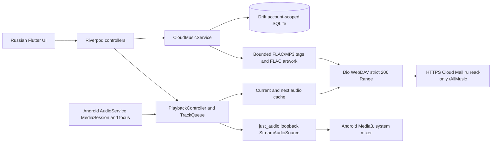

# Android architecture — aN-cLmL

- `lib/domain`: track models, album ordering, queue; free of platform imports.
- `lib/cloud`: read-only WebDAV and credential lifecycle; never redirect authenticated requests.
- `lib/data`: Drift catalog, bounded metadata/art, temporary current+next audio cache, playback controller.
- `lib/platform/android`: foreground audio session, Android Media3 integration and opaque OS media IDs.
- `lib/app`, `lib/presentation`: Russian UI, library navigation and Now Playing.

Each HTTP range GET <=64 KiB and validates 206/Content-Range dialect; only `/AllMusic`; no cloud writes. Thumbnail cache is persistent and account-scoped (64 MiB); temporary audio cache is bounded (512 MiB) and not an offline library. No production-signing key in repository.

The source code and original architecture decisions were historically cross-platform; their full history remains in Git. A separate [current Android spec](ANDROID_SPEC_RU.md) is authoritative for scope. Current known limits: no accepted Huawei live-cloud/audio evidence, no proven DB migration or 50k UI paging, preview-only debug signing.
