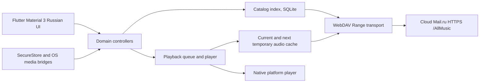

# Three-platform architecture (target and implementation status)

The original Flutter shell and M2-A read-only WebDAV client are reused as a verified starting point, not yet a complete music player. The large application is assembled incrementally under independently verifiable interfaces.

Dependencies point toward domain abstractions. Only platform composition knows Android, Windows or Linux. XML/tag parsing and image processing must not block the Flutter UI isolate. No operating-system mounted WebDAV is used as the primary path. Sensitive Basic auth headers cannot reach logs.

## Stages

- M0: short bounded live WebDAV probe and package/engine compatibility research, including Linux.
- M1: official Linux runner, three platform CI and layer boundary enforcement.
- M2: incremental catalog/index and metadata extraction with SQLite.
- M3: tracks/albums/artists/search/artwork.
- M4: native audio, mini-player and queue.
- M5: 2-track caching, bounded preloading and seek.
- M6+: playback modes, media session/MPRIS/SMTC, Flatpak and release packages.

Existing M2-A remains isolated to the WebDAV client and secure connection flow; no unverified audio or SQLite implementation should be reported as complete.
